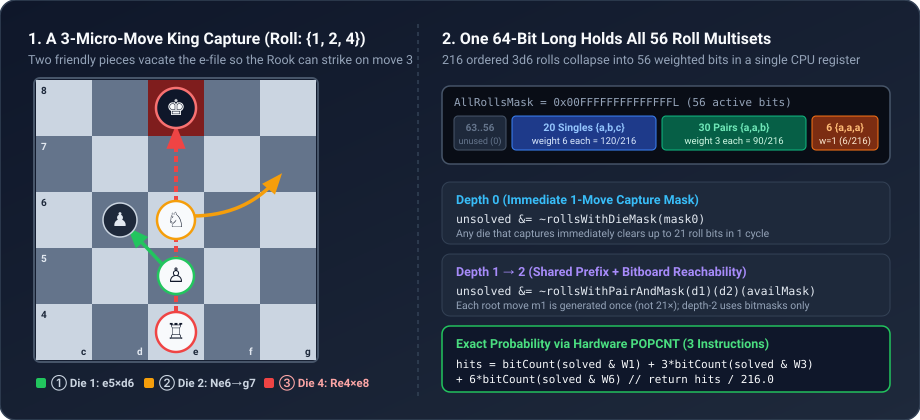
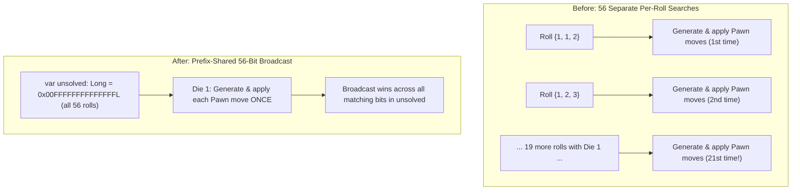
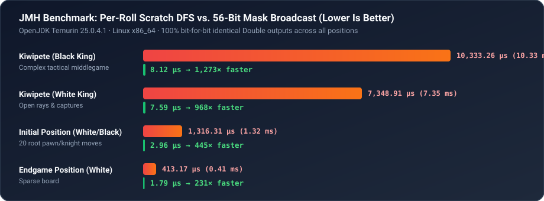

In earlier posts of this series, we built the foundation of our Scala 3 Dice Chess engine: [zero-cost domain types](), [$O(1)$ leaper bitboards](), and [Magic Bitboard sliding attacks]().

Those building blocks make classical single-move lookups fast. Today I want to share the story of optimizing the single most important—and previously most expensive—function in our entire engine: **King Capture Probability (`KingCaptureProbability`)**.

By rethinking the algorithm from first principles and hunting down two subtle allocation traps in Scala 3, we reduced the execution time of exact 3-ply capture probability on complex midgame boards from **10.33 milliseconds to 8.12 microseconds**—a **1,273× speedup**—while preserving **100% bit-for-bit identical `Double` outputs** across every position.

---

## Why "Check" Is a Probability Over 216 Dice Rolls

In classical chess, asking _"is the King in check?"_ is a boolean question. You union the attack masks from the King's square, intersect them with enemy pieces, and get a `true` or `false` answer in a few nanoseconds.

In **Dice Chess**, the rules are radically different:

1. **There is no check or checkmate.** You win the game by literally capturing the opponent's King on your turn.
2. **Every turn rolls three six-sided dice (`3d6`).** Each die (`1` = Pawn, `2` = Knight, `3` = Bishop, `4` = Rook, `5` = Queen, `6` = King) lets you move one piece of that type, in any order, for up to **three micro-moves in a single turn**.

Because a player can chain three micro-moves together, a King that looks completely safe in classical chess might actually be in mortal danger:

- **Move 1 (Die `1`, Pawn):** A pawn captures sideways, opening a blocked file.
- **Move 2 (Die `2`, Knight):** A knight jumps away, vacating the second square on that file.
- **Move 3 (Die `4`, Rook):** A rook slides down the newly cleared file and captures the enemy King.

Or even more exotically: a player rolls `{6, 4, 4}`, spends the King (`6`) and Rook (`4`) dice together to **castle (`O-O-O`)**, landing the Rook on `d1`, and immediately uses the third die (`4`) to slide that same Rook to `d8` and capture the enemy King.



### Why Our Bots Live and Die by This Function

When an AI bot searches for the best turn, it cannot just count material. Leaving your King exposed to a `46/216` ($21.3\%$) three-step capture combination—or leaving your Queen hanging to a `91/216` ($42.1\%$) combination—can lose the game on the spot.

Consequently, our search bots invoke `kingCaptureProbability` and `queenCaptureProbability` for both White and Black (four calls per evaluated position) constantly: inside leaf evaluations, safety gates, and feature extractors.

Here is the math the function has to solve on every call:

- Three six-sided dice produce $6^3 = 216$ ordered outcomes.
- Because the player can reorder their dice freely, those $216$ outcomes collapse into **56 distinct sorted multisets**:
  - **6 triples** (`{1,1,1}` .. `{6,6,6}`), each occurring in **$1$** way ($6 \times 1 = 6$).
  - **30 pairs** (`{1,1,2}` .. `{6,6,5}`), each occurring in **$3$** ways ($30 \times 3 = 90$).
  - **20 distinct triples** (`{1,2,3}` .. `{4,5,6}`), each occurring in **$6$** ways ($20 \times 6 = 120$).
- For every one of those 56 multisets, we must determine whether **any** legal sequence of up to 3 micro-moves captures the target piece, and sum the weights:

$$\text{KCP}(\text{state}, \text{target}) = \frac{1}{216} \sum_{i=0}^{55} w_i \cdot \mathbb{I}\bigl(\text{roll}_i \text{ can capture target in } \le 3 \text{ micro-moves}\bigr)$$

When a single KCP call took **1.3 ms** on the starting board and **10.3 ms** in a tactical midgame (`kiwipete`), extracting four capture probabilities for a single position cost **25–30 milliseconds**. Under a real-time game clock, that bottleneck dictated how many positions per second our strongest bots could afford to evaluate.

---

## Act I: Why `make/undo` Only Gave Us 1.6×

In our original implementation, the evaluator looped over all 56 weighted rolls and ran a 3-ply depth-first search (DFS) using our immutable `GameState.makeMove(move)` method.

Every node in that DFS cloned a 64-element mailbox array and allocated a fresh `GameState` on the heap. Following classic chess-programming wisdom, our first optimization pass replaced immutable transitions inside KCP with a dedicated mutable board—`KcpScratchBoard`—supporting in-place `makeMoveInPlace` and `undoMove`.

We expected an order-of-magnitude speedup. Instead, JMH gave us a cold shower: `kiwipete` dropped by only **~1.4× to 1.6×** (still taking **7.35 ms** for White and **10.33 ms** for Black on our Linux x86_64 benchmark server).

Why did eliminating board cloning barely move the needle? When we profiled the hot loop, we uncovered two silent allocation traps in `MoveGenerator` and one massive algorithmic redundancy in `KingCaptureProbability`.

---

## Act II: Two Silent Allocation Traps in Scala 3

### Trap 1: The `List.apply(buf.take(count)*)` Illusion

Inside `MoveGenerator.generatePieceMoves`, whoever originally wrote the code had tried to be fast: moves were generated as packed 16-bit integers into a local `new Array[Int](256)` buffer.

And then the last line of the method returned the result like this:

```scala
// Looks innocent, allocates three times on every call!
val buf   = new Array[Int](256)
val count = generateIntoBuffer(state, pieceType, buf)
List.apply(buf.take(count)*)
```

Look closely at what happens every single time `generatePieceMoves` is called:

1. `new Array[Int](256)` allocates a 1 KB array on the heap.
2. `buf.take(count)` allocates _another_ `Array[Int]` of length `count` and copies the elements over.
3. Passing `buf.take(count)*` as Scala varargs wraps the array and `List.apply` walks it to allocate `count` linked-list `::` nodes on the heap!

We had written zero-allocation bitboard math to fill `buf`, only to throw it away on the return line.

**The Fix:** We introduced a package-private zero-allocation entry point, `MoveGenerator.generatePieceMovesInto`, which writes encoded 16-bit moves directly into a caller-owned `Array[Int]` and returns `count: Int`:

```scala
private[engine] def generatePieceMovesInto(
    myPieces: Long,
    enemyPieces: Long,
    activePieces: Long,
    enemyKings: Long,
    myRooks: Long,
    enPassant: Long,
    castlingRights: Int,
    isWhite: Boolean,
    die: Int,
    out: Array[Int]
): Int
```

The caller allocates two tiny arrays (`moves0` for depth 1 and `moves1` for depth 2) **once** at the start of `captureProbability` and reuses them across the entire traversal. Heap allocations inside move generation dropped to **zero**.

### Trap 2: Rebuilding FEN Strings Just to Check Castling

While inspecting `MoveGenerator.tryCastle`, we spotted a second surprise:

```scala
// Before: inside MoveGenerator.tryCastle
val canKingside =
  if color.isWhite then state.castlingRights.contains('K')
  else state.castlingRights.contains('k')
```

In our domain model, castling rights are stored as 4 bits inside the packed 32-bit `state.flags: GameFlags` header (`1 = K`, `2 = Q`, `4 = k`, `8 = q`). However, `state.castlingRights` was a convenience helper intended for FEN serialization that constructed a new `StringBuilder` and `String` (`"KQkq"`) every time it was accessed!

Every time the engine generated King moves, it was formatting a FEN substring and scanning characters just to test a single bit. Replacing `state.castlingRights.contains('K')` with `(state.flags.castlingRights & 1) != 0` turned a heap allocation into a single CPU instruction.

---

## Act III: Inverting the Search — 56 Rolls in One 64-Bit `Long`

Fixing the allocations made individual nodes fast, but the biggest bottleneck was structural: **we were still running 56 separate searches**.

Think about how the 56 multisets of `3d6` overlap. How many of the 56 multisets contain a `1` (Pawn)?
Exactly **21 multisets** (`{1,1,1}`, `{1,1,2}`, ..., `{1,2,3}`, ..., `{1,6,6}`).

When the outer loop iterated over the 56 rolls one by one:



In `kiwipete`, if none of White's pawns can immediately capture the Black King, the old algorithm generated White's pawn moves, applied each one, generated replies, and undid them **21 separate times**!

### Packing 56 Multisets into a Single `Long`

Wait—there are **56** multisets, and a Scala `Long` has **64 bits**.

Instead of asking _"given roll $r$, is there a winning 3-move path?"_, we inverted the problem: **traverse the move tree once, and broadcast every capture against a 56-bit bitmask of still-unsolved rolls.**

At class initialization, we precompute a handful of tiny static bitmask tables over the 56 indices of `DiceRolls.weighted`:

```scala
private inline val AllRollsMask = 0x00ffffffffffffffL // bits 0..55

// For a 6-bit mask of winning dice (bits 1..6), which of the 56 rolls contain at least one?
private val rollsWithDieMask: Array[Long] = ...

// Given first die d1, second die d2, and a 6-bit mask of winning 3rd dice,
// which of the 56 rolls contain {d1, d2, d3} for any d3 in availMask?
private val rollsWithPairAndMask: Array[Array[Array[Long]]] = ...

// Partition of the 56 bits by their multinomial weight (1, 3, or 6):
private val weight1RollsMask: Long = ... // 6 triples {a,a,a}
private val weight3RollsMask: Long = ... // 30 pairs {a,a,b}
private val weight6RollsMask: Long = ... // 20 singles {a,b,c}
```

Now, at the start of `captureProbability`, we initialize a single 64-bit register:

```scala
var unsolved: Long = AllRollsMask
```

#### Step 1: Depth-0 Immediate Captures in $O(1)$

Before generating a single move, we check which of the attacker's piece types (`1..6`) already attack the target square on the initial board. Because the target is stationary, we compute the attacks _outward_ from the target square once (`targetPawnMask`, `targetKnightMask`, `diagRay0`, `orthoRay0`, `targetKingMask`) and intersect them with the attacker's piece bitboards.

That gives us a 6-bit mask `mask0` of dice that can capture on the very first micro-move. One bitwise instruction knocks out every roll containing any of those dice:

```scala
unsolved &= ~rollsWithDieMask(mask0)
if unsolved == 0L then break(1.0)
```

If a Knight and a Bishop both attack the King, `mask0` clears **36 of the 56 rolls** before the search even starts!

#### Step 2: Prefix Sharing + Incremental Slider Rays at Depth 1

For the remaining `unsolved` rolls, we iterate over the first die `d1` from `1` to `6`. If `(unsolved & rollsWithFirstDie(d1)) == 0L`, we skip `d1` completely.

Otherwise, we call `MoveGenerator.generatePieceMovesInto` **once** for `d1`, writing into `moves0`. For each first move `m1`:

- Instead of mutating a board object on the heap, we update the eight 64-bit piece bitboards (`w1, b1, p1, n1, bi1, r1, q1, k1`) in local CPU registers using fast bitwise shifts and XORs.
- What about sliding attacks (Bishops, Rooks, Queens) toward the target King? A naive check would recompute `MagicBitboards.bishopAttacks` and `rookAttacks` after every move `m1`. Instead, we check whether the squares touched by `m1` (`changed1 = (1L << from1) | (1L << to1)`) even intersect the full unblocked rays of the target square (`targetDiagMask`, `targetOrthoMask`):

```scala
val diagRay1 =
  if (changed1 & targetDiagMask) != 0L then unionDiagAttacks(targets, allPieces1)
  else diagRay0
val orthoRay1 =
  if (changed1 & targetOrthoMask) != 0L then unionOrthoAttacks(targets, allPieces1)
  else orthoRay0
```

In the vast majority of moves, `changed1` does not touch the King's diagonal or file/rank, so updating the sliding rays costs **zero table lookups**.

From that updated state, we immediately compute the 6-bit mask `mask1` of piece types that can capture the target on micro-move 2, and clear all matching 56-bit rolls at once:

```scala
if mask1 != 0 then
  unsolved &= ~rollsWithTwoDiceAndMask(d1)(mask1)
```

#### Step 3: Analytical 1-Step Bitboard Reachability at Depth 2

What if `m1` doesn't enable a capture on move 2, and we need all three micro-moves `(d1, d2, d3)`?

In the old DFS, depth 2 generated a move list for `d2`, applied each move `m2`, and then generated _another_ move list for `d3` just to check if any move landed on `targetSq`.

With bitboards, we don't need to generate moves for `d3`—and for `d2 != d3`, we often don't even need to generate moves for `d2`! After `m1`, only two things can make piece `d3` capture the target on move 3:

1. **Direct arrival (`d2 == d3` or promotion):** A piece of type `d2` moves to a square from which it attacks the target (for example, a Knight jumping into `knightReach2Mask`, or a Rook sliding onto `orthoRay1`).
2. **Ray unblocking (`d3` is a Bishop, Rook, or Queen):** A slider of type `d3` is already aligned with the target King, separated by **exactly one blocking piece** (`blockerBit`) on the ray. Then micro-move 2 only needs to move a friendly blocker off `blockerBit` (using die `d2`), or capture an enemy blocker on `blockerBit`!

We test that reachability directly with bitmasks (`canPieceReachAttackInOneMove`), and clear all solved rolls via `unsolved &= ~rollsWithPairAndMask(d1)(d2)(availMask)`.

#### Step 4: Hardware `POPCNT` for the Final Probability

Once the loop finishes (or breaks early as soon as `unsolved == 0L`), converting the 56-bit mask of solved rolls into an exact weighted sum over 216 outcomes takes three hardware `POPCNT` instructions (`java.lang.Long.bitCount`):

```scala
val solved = AllRollsMask & ~unsolved
val count =
  java.lang.Long.bitCount(solved & weight1RollsMask) +
    java.lang.Long.bitCount(solved & weight3RollsMask) * 3 +
    java.lang.Long.bitCount(solved & weight6RollsMask) * 6

count.toDouble / DiceRolls.totalOrderedRolls // count / 216.0
```

---

## Act IV: Trust, but Verify — Differential Oracle Testing

Replacing a short, obviously-correct recursive DFS with 700 lines of bit-parallel geometry and register state transitions carries a real risk: **missing a weird chess edge case**.

What if an en-passant capture removes a pawn on `d5` that wasn't on `toSq` (`d6`), uncovering a diagonal Bishop attack on the King? What if a pawn promotes to a Knight on move 1, jumps on move 2, and captures the King on move 3? What if a player has multiple Queens on the board?

To guarantee that our optimization had **zero behavioral drift**, we did not delete the old `KcpScratchBoard` per-roll DFS logic. Instead, we moved it into `KingCaptureProbabilitySuite` as a **reference oracle** and ran differential tests asserting **exact bit-for-bit `Double` equality**:

1. **Curated Tactical Corpus:** Positions specifically engineered to trigger 3-ply castling-rook attacks (`O-O` and `O-O-O`), en-passant discovered attacks, double ray unblocking, and multi-step promotions (including underpromotions to Knight).
2. **Stochastic Random-Walk Fuzzing:** 200 deterministically seeded random games played out up to 30 plies, comparing `kingCaptureProbability` and `queenCaptureProbability` for both White and Black against the reference DFS oracle (**800 full oracle comparisons**)—all matching to the last floating-point bit, with **98.98% statement coverage** across the `rules` module.

---

## The JMH Benchmark Results

We ran `KingCaptureProbabilityBenchmark` using JMH (`-wi 3 -i 5 -f 1`, OpenJDK Temurin 25.0.4.1 on an isolated Linux x86_64 machine) across the standard starting position, the tactical midgame benchmark position **Kiwipete**, and a sparse endgame position.



Here is the complete before-and-after table (`us/op` = microseconds per call, lower is better):

| Benchmark                 | Position   | Target Color | Scratch-Board DFS (`µs/op`) | 56-Bit Broadcast (`µs/op`) |    Speedup |
| :------------------------ | :--------- | :----------- | --------------------------: | -------------------------: | ---------: |
| `kingCaptureProbability`  | `initial`  | White        |         `1,316.313 ± 4.095` |        **`2.956 ± 0.009`** |   **445×** |
| `kingCaptureProbability`  | `initial`  | Black        |         `1,302.727 ± 2.460` |        **`2.894 ± 0.142`** |   **450×** |
| `kingCaptureProbability`  | `kiwipete` | White        |        `7,348.910 ± 30.620` |        **`7.591 ± 0.044`** |   **968×** |
| `kingCaptureProbability`  | `kiwipete` | Black        |      `10,333.262 ± 522.815` |        **`8.120 ± 0.023`** | **1,273×** |
| `kingCaptureProbability`  | `endgame`  | White        |          `413.166 ± 23.240` |        **`1.787 ± 0.004`** |   **231×** |
| `kingCaptureProbability`  | `endgame`  | Black        |           `330.873 ± 0.545` |        **`1.676 ± 0.080`** |   **197×** |
| `queenCaptureProbability` | `initial`  | White        |        `1,303.602 ± 66.537` |        **`2.950 ± 0.007`** |   **442×** |
| `queenCaptureProbability` | `initial`  | Black        |         `1,314.228 ± 6.077` |        **`2.950 ± 0.003`** |   **445×** |
| `queenCaptureProbability` | `kiwipete` | White        |        `6,079.477 ± 37.510` |        **`6.312 ± 0.295`** |   **963×** |
| `queenCaptureProbability` | `kiwipete` | Black        |        `7,523.053 ± 46.169` |        **`6.012 ± 0.023`** | **1,251×** |

---

## Key Takeaways

1. **Data-structure micro-optimizations cannot fix redundant work.** Replacing immutable board copies with a mutable `make/undo` scratch board gave us a modest `1.6×` gain because we were still exploring the same root moves 21 times across 56 separate roll searches. Inverting the loop to broadcast over a 56-bit `Long` register unlocked the other `800×`.
2. **Watch the return boundary of your "zero-allocation" helpers.** A fast primitive array inside a method is wasted if the final line converts it via `List.apply(buf.take(count)*)` or calls a helper property that quietly builds a `String`.
3. **Keep the slow, simple algorithm as your test oracle.** When writing low-level bitboard geometry in Scala 3, keeping the reference DFS in your test suite lets you move fast and prove bit-exact equivalence across hundreds of random games.

For our bots, what used to be a **25–30 millisecond** tax per evaluated position now completes in **~25 microseconds**—turning an expensive 3-ply search into a microsecond primitive and freeing the search budget to look deeper into the game.
